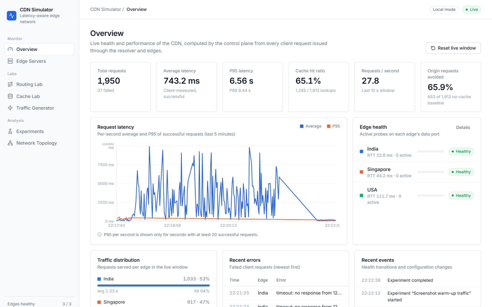
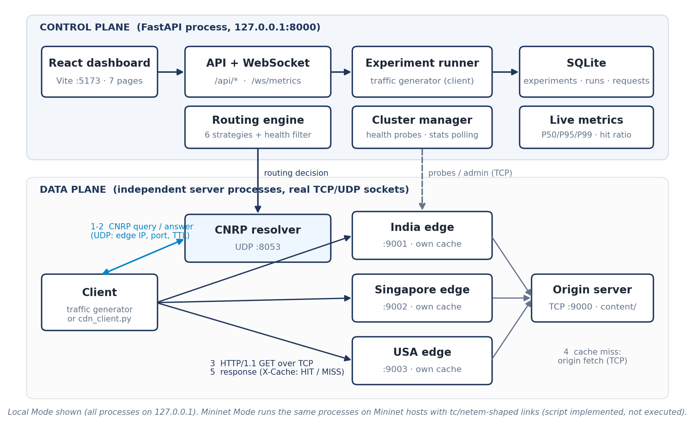
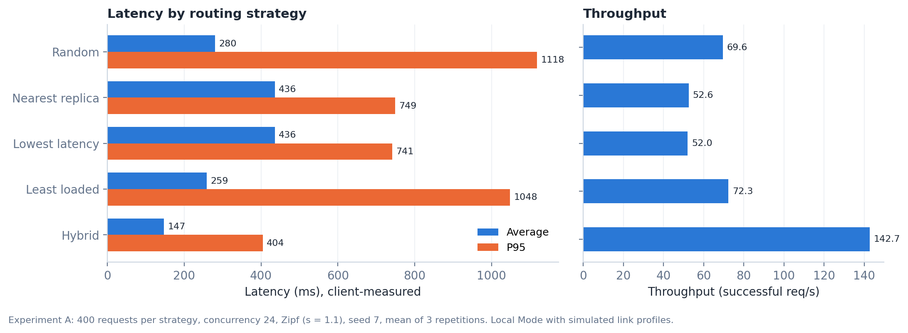
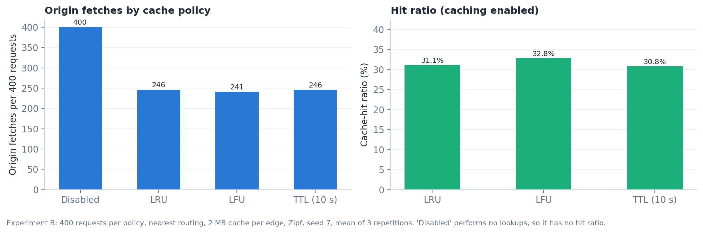

<div align="center">


<br>

# EdgeFlow

### Distributed CDN Simulator with Latency-Aware Routing and Adaptive Caching

A miniature, genuinely networked Content Delivery Network built for the
**Computer Networks Laboratory (CSE20110)** at **Dr. Vishwanath Karad MIT World Peace University, Pune**.


[Overview](#overview) •
[Features](#key-features) •
[Architecture](#architecture) •
[Getting Started](#getting-started) •
[Results](#experimental-results) •
[Documentation](#documentation) •
[Team](#team)

</div>

---

## Overview

**EdgeFlow** is a working, small-scale CDN: an origin server, three independent edge server
processes with their own caches, a UDP name resolver that routes each client to an edge, and a
FastAPI control plane with a React dashboard for live monitoring and repeatable experiments.

Every component talks over real sockets — HTTP/1.1 over TCP for content delivery and a documented
DNS-inspired binary protocol (**CNRP**) over UDP for resolution — so the traffic can be inspected in
Wireshark and the behaviour of routing and caching strategies can be measured rather than assumed.

<div align="center">
  
  <br><sub><i>Live dashboard — overview of edge health, latency, hit ratio and throughput</i></sub>
</div>

## Key Features

| Area | What is implemented |
|---|---|
| **Real networking** | Strict asyncio HTTP/1.1 server and client over TCP; CNRP binary resolver protocol over UDP (success, NXDOMAIN, FORMERR, BADVERS, drop, timeout) |
| **Routing** | Six strategies — random, nearest replica, lowest latency, least loaded, hybrid latency/load/loss score, and health-aware failover — all health-filtered and explained |
| **Adaptive caching** | Per-edge LRU, LFU, TTL or disabled; byte capacity, eviction log, invalidation, cache warming and request coalescing |
| **Health management** | Active probes plus passive client-failure detection; failure injection and restore with measured detection and recovery times |
| **Experiments** | Routing comparison, cache comparison, server failure and link degradation — seeded, repeatable, persisted in SQLite and exportable as CSV |
| **Dashboard** | Seven pages (Overview, Edge Servers, Routing Lab, Cache Lab, Traffic Generator, Experiments, Network Topology) fed by REST and a WebSocket stream |
| **Mininet mode** | Topology script with `tc`/`netem`-shaped links for running on real emulated networks |

## Architecture

<div align="center">
  
</div>

1. A client sends a **CNRP query over UDP** to the resolver (port `8053`).
2. The **routing engine** filters out unhealthy edges and selects one using the active strategy.
3. The client downloads the object from that edge over **HTTP/1.1** (ports `9001–9003`).
4. On a cache **MISS** the edge fetches from the **origin** (port `9000`), stores it according to its
   cache policy, and serves it; subsequent requests are cache **HITs**.
5. The **control plane** (port `8000`) collects metrics, runs health checks and experiments, and
   streams live statistics to the dashboard over WebSocket.

Simulated edge locations: **India** (18 ms), **Singapore** (42 ms) and **USA** (110 ms), each with
its own bandwidth, packet-loss and concurrency profile.
See [docs/ARCHITECTURE.md](docs/ARCHITECTURE.md) for the full design and protocol specification.

## Tech Stack

| Layer | Technologies |
|---|---|
| Backend | Python 3.12+, asyncio, FastAPI, Uvicorn, Pydantic, SQLite, psutil |
| Frontend | React 18, TypeScript, Vite, React Router, Recharts, Lucide icons |
| Testing | pytest, pytest-asyncio, httpx, Vitest, Testing Library |
| Network emulation | Mininet, Linux `tc`/`netem` |

## Getting Started

### Prerequisites

- **Python** 3.12 or newer
- **Node.js** 18 or newer, with npm
- Free local ports: `8000`, `8053/udp`, `9000–9003`, `9101–9103`, `5173`

### 1. Clone the repository

```bash
git clone https://github.com/GeetEditz/Edge-Flow.git
cd Edge-Flow
```

### 2. Start the backend

The control plane launches the origin and the three edge server processes automatically.

```bash
cd backend
python -m venv .venv

# Windows
.venv\Scripts\python -m pip install -r requirements.txt
.venv\Scripts\python -m uvicorn app.main:app --host 127.0.0.1 --port 8000

# Linux / macOS
.venv/bin/python -m pip install -r requirements.txt
.venv/bin/python -m uvicorn app.main:app --host 127.0.0.1 --port 8000
```

A sample content catalogue (≈ 9 MB, 32 files) is generated into `backend/content/` on first start.
Runtime data is stored in `data/cdn.sqlite3` and logs in `data/logs/`.

### 3. Start the frontend

In a second terminal:

```bash
cd frontend
npm install
npm run dev
```

### 4. Open the dashboard

| Service | URL |
|---|---|
| Dashboard | <http://127.0.0.1:5173> |
| OpenAPI docs | <http://127.0.0.1:8000/docs> |

### 5. Request content from the command line

```bash
cd backend
.venv\Scripts\python scripts\cdn_client.py images/photo-05.png --repeat 2   # first MISS, then HIT
```

## Usage

| Task | Dashboard | API |
|---|---|---|
| Generate traffic | Traffic Generator → *Start traffic* | `POST /api/experiments {"name":"t","type":"single","start":true}` |
| Compare routing algorithms | Routing Lab → *Compare routing strategies* | `type: "routing_comparison"` |
| Compare caching policies | Cache Lab → *Compare cache policies* | `type: "cache_comparison"` |
| Simulate a server failure | Edge Servers → *Simulate failure* / *Restore* | `POST /api/servers/india-edge/simulate-failure`, `.../restore` |
| Degrade a link | Edge Servers → *Network profile* | `POST /api/servers/{id}/profile` |
| Change routing / cache policy | Routing Lab / Cache Lab | `POST /api/routing/strategy`, `POST /api/cache/policy` |
| Export results | Experiments → *Runs CSV* / *Requests CSV* | `GET /api/experiments/{id}/export.csv` |

### Configuration

Environment variables (see `backend/app/config.py`):

| Variable | Purpose |
|---|---|
| `CDN_MODE` | `local` or `mininet` |
| `CDN_LAUNCH` | `subprocess`, `inprocess` or `external` |
| `CDN_TOPOLOGY` | Path to a JSON topology file |
| `CDN_DB_PATH`, `CDN_CONTENT_DIR` | Database and content locations |
| `CDN_API_HOST`, `CDN_API_PORT` | Control-plane bind address |
| `CDN_RESOLVER_HOST`, `CDN_RESOLVER_PORT` | UDP resolver bind address |
| `CDN_CORS_ORIGINS` | Allowed dashboard origins |
| `CDN_API_URL` | Backend URL used by the frontend dev server (default `http://127.0.0.1:8000`) |

## Experimental Results

All numbers were measured in Local Mode on a single machine with simulated link profiles; they
describe behaviour *in this simulator*. Full methodology in [docs/EXPERIMENTS.md](docs/EXPERIMENTS.md).

**Routing comparison** — 400 requests, concurrency 24, mean of 3 runs:

| Strategy | Avg latency | P95 | Throughput |
|---|---|---|---|
| Random | 279.8 ms | 1118.2 ms | 69.6 req/s |
| Nearest replica | 436.0 ms | 748.7 ms | 52.6 req/s |
| Lowest latency | 436.2 ms | 741.3 ms | 52.0 req/s |
| Least loaded | 258.5 ms | 1047.7 ms | 72.3 req/s |
| **Hybrid** | **146.9 ms** | **404.3 ms** | **142.7 req/s** |

**Cache comparison** — any cache policy cut origin fetches by ~38–40 % and origin bytes by ~54–57 %
versus no caching; LFU was marginally best under Zipf-distributed popularity.

**Failure handling** — passive detection marked a failed edge unhealthy in ~2 ms, and the first
successful failover request completed ~80 ms after the failure was injected.

<div align="center">
  
  &nbsp;
  
</div>

## Testing

```bash
cd backend  && .venv\Scripts\python -m pytest   # 79 tests: routing, caching, HTTP/UDP, API, integration, WebSocket
cd frontend && npm test                         # 10 tests: WebSocket reconnection, API errors, UI states
cd frontend && npm run build                    # type-check + production build
```

All 79 backend and 10 frontend tests pass, and 16 scripted browser checks confirm that every
dashboard page renders without console errors. Logs are in [`submission/evidence/`](submission/evidence).

## Project Structure

```
Edge-Flow/
├── backend/
│   ├── app/
│   │   ├── main.py          # FastAPI app, error handling, structured JSON logs
│   │   ├── api/             # REST routes + WebSocket /ws/metrics
│   │   ├── core/            # Services, cluster/health manager, launcher, metrics
│   │   ├── networking/      # HTTP/1.1 server & client, CNRP UDP resolver
│   │   ├── routing/         # Routing strategies and engine
│   │   ├── caching/         # LRU / LFU / TTL policies, per-edge cache
│   │   ├── origin/          # Origin server, sample content generator
│   │   ├── edge/            # Edge server, simulated network profile
│   │   ├── traffic/         # Workload generator and CDN client
│   │   ├── experiments/     # Experiment runner
│   │   ├── persistence/     # SQLite layer
│   │   └── schemas/         # Pydantic request models
│   ├── scripts/             # generate_content.py, cdn_client.py
│   └── tests/               # pytest suite
├── frontend/src/            # React + TypeScript dashboard
├── mininet/                 # Mininet topology and guide
├── docs/                    # Architecture, API, experiments, Wireshark guide
├── scripts/                 # Report, presentation and figure generators
└── submission/              # Final report, presentation, figures and evidence
```

## Documentation

| Document | Contents |
|---|---|
| [Architecture & Protocol](docs/ARCHITECTURE.md) | System design and CNRP wire-format specification |
| [API Reference](docs/API.md) | REST and WebSocket endpoints |
| [Experiments](docs/EXPERIMENTS.md) | Methodology and measured results |
| [Wireshark Guide](docs/WIRESHARK.md) | Capturing and dissecting CDN traffic |
| [Mininet Mode](mininet/README.md) | Running on an emulated network |
| [Submission Package](submission/README.md) | Report, presentation and evidence |

## Known Limitations

- Local Mode runs everything on one machine over loopback; geographic locations and link conditions
  are **simulated** inside each edge.
- CNRP is DNS-inspired, not standards-compliant DNS.
- Caches are in memory; a policy change or edge restart empties them. TTL is a fixed lifetime, not
  HTTP freshness, and conditional requests are not supported.
- Only one experiment runs at a time.
- Mininet Mode and the Wireshark procedure have not yet been executed on a Linux host.

## Team

**Group No. 2** · Third Year B.Tech. Computer Engineering and Technology ·
Academic Year 2026–2027

| Sr. No. | Name | PRN |
|:---:|---|:---:|
| 1 | More Geet Dattatraya | 1262250006 |
| 2 | Shinde Soham Manoj | 1262250009 |
| 3 | Jagtap Prasad Sachin | 1262250018 |
| 4 | Gaikwad Shreyash Sachin | 1262250005 |

**Project Guide:** Dr. Swati — Course Faculty, Computer Networks Laboratory (CSE20110)

## Acknowledgements

We thank **Dr. Swati** for guidance and support throughout this project, and **Dr. Vishwanath Karad MIT World
Peace University, Pune** for providing the resources and learning environment that made it possible.

---

<div align="center">
<sub>Developed as a Computer Networks Laboratory mini project at MIT World Peace University, Pune.</sub>
</div>
